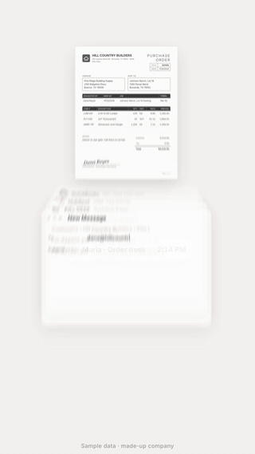
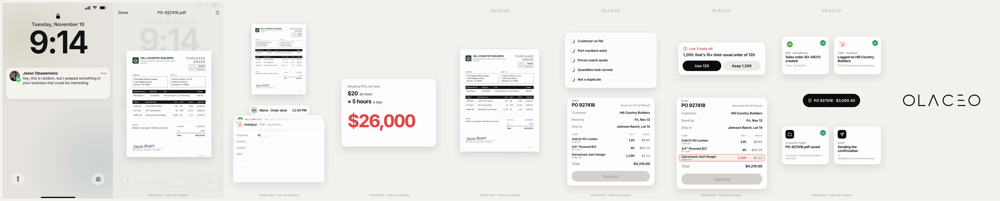
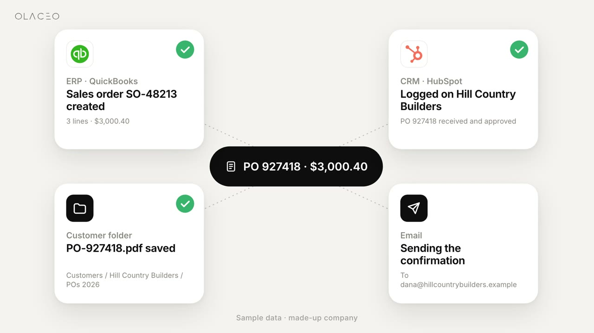

<div align="center">

# Continuum Walkthrough

**An AI-agent skill that builds pain-first walkthrough videos, from code.**
One document travels in a single continuous shot: from the prospect's pain → what it costs them → the fix.



[▶︎ Watch the full 58 s example (9:16, with sound)](docs/preview-9x16.mp4)

`Claude Code` · `Codex` · `ElevenLabs voice` · `60 fps motion blur` · `9:16 + 16:9`

</div>

---

## What you get



| 1 Hook | 2 Document | 3 Pain | 4 Cost | 5 Turn | 6 Checks | 7 Exception | 8 Filed | 9 Logo |
|---|---|---|---|---|---|---|---|---|
| A real-looking iMessage: *"Hey, this is random… but I peeped something in your business"* | The PO arrives and opens as a believable PDF | Someone retypes it into the ERP, the CRM, a folder and email | **$20/hr × 5 h × 260 days = $26,000 a year** | The same PDF comes back | Read and checked automatically | A real problem gets flagged; one tap fixes it | Filed in all 4 places, with a receipt | The brand logo, alone, fades out |

The example scored **10/10** with its owner: *"I love the animations, sfx, etc, and the continuity type of mechanics."*

---

## How it works

```mermaid
flowchart LR
  A[Q&A<br/>12 questions] --> B[Beat sheet<br/>+ script]
  B --> C[Voice<br/>ElevenLabs]
  C --> D[Whisper check<br/>+ word times]
  D --> E[Picture<br/>seek&#40;t&#41; HTML]
  E --> F[Sound<br/>cue-sheet mix]
  F --> G{Ghost gate}
  G -- PASS --> H[Render<br/>60 fps, 2 formats]
  G -- FAIL --> E
  H --> I[4 MP4s<br/>+ score]
```



| Step | What happens | File |
|---|---|---|
| **Q&A** | The agent asks about the document, your numbers, the worker's name, the tools, the opener, the voice and the CTA | `references/intake-qa.md` |
| **Voice** | Two takes of every line from ElevenLabs. Whisper checks each one word for word and gives word timings | `scripts/vo_gen.mjs`, `scripts/vo_verify.sh` |
| **Picture** | One pure function, `seek(t)`. Every frame is reproducible, springs never wobble, and every animation lands on the word that names it | `engine/engine.js`, `engine/starter.html` |
| **Sound** | Every visible event gets a sound you can hear on a phone. The voice leads and the music ducks under it. Output is −14 LUFS | `scripts/mix.py`, `references/sound-map.md` |
| **Gate** | The build fails if anything stays half-visible for more than 3 s (the "ghost" bug) | `scripts/ghost_audit.mjs` |
| **Render** | 60 fps, real motion blur (8 subframes), 9:16 and 16:9, each with Voice+Music and Voice+SFX | `scripts/render.mjs`, `scripts/render.sh` |



---

## Install (2 minutes)

```bash
git clone https://github.com/whoisjaso/continuum-walkthrough
ln -s "$PWD/continuum-walkthrough" ~/.claude/skills/continuum-walkthrough   # Claude Code
ln -s "$PWD/continuum-walkthrough" ~/.codex/skills/continuum-walkthrough    # Codex
```

Then just ask your agent:

> *"Make me a walkthrough video like the PO Desk one, for invoices."*

### Needs

| Tool | Install |
|---|---|
| Node 20+ and Playwright | `npm i playwright-core` (or set `PW_DIR`) |
| Chrome | Any Chrome or chrome-headless-shell (`CHROME=/path`). Optional |
| ffmpeg | `brew install ffmpeg` |
| Python 3 + numpy | `pip install numpy` |
| whisper.cpp | `brew install whisper-cpp` + the model `ggml-small.en-q5_1.bin` |
| ElevenLabs key | `export ELEVENLABS_API_KEY=…` (never commit it) |
| Sound effects | Your own library. `references/sound-map.md` lists the kind of sound for each role |

---

## Repo map

```
continuum-walkthrough/
├── SKILL.md              ← what the agent follows (pipeline, story shape, rules)
├── engine/               ← animation engine + starter template
├── scripts/              ← voice, verify, mix, gate, render
├── references/           ← Q&A, beat sheet, sound map, lessons ledger
├── examples/po-desk/     ← the 10/10 example: page, script, cue sheet
└── docs/                 ← images for this README
```

---

## Good to know

> [!IMPORTANT]
> **The ElevenLabs free plan has no commercial licence.** It gives 10,000 characters a month, which is about 5 videos. That's fine for drafts. Generate the final voice on a paid plan before you post anything that markets a business.

> [!NOTE]
> - **Logos imply integrations.** Only show the tools a prospect actually uses, or that you really connect to.
> - **The example data is made up** and labelled "Sample data · made-up company" on screen.
> - **Not included:** the sender headshot, music and sound files, because they carry their own rights. Add your own: `examples/po-desk/assets/jason.jpg` and a `music/` file.

<div align="center"><sub>Made by OLACEO · built with Claude Code</sub></div>
